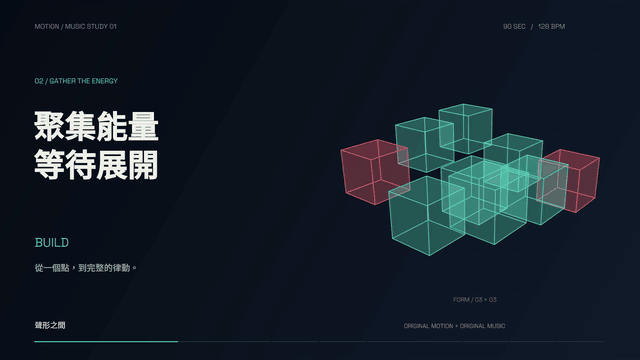

# Electronic Music Production

An independent Codex skill for composing, arranging, synthesizing, mixing,
mastering, and revising electronic music across dance, ambient, downtempo,
experimental, and hybrid styles.

獨立的電子音樂製作 Skill，涵蓋舞曲、氛圍、低速、實驗與混合風格的作曲、音色、編曲、混音、母帶與檢查。
The instructions and production references are written in Traditional Chinese.

The included audio starter produces music on its own. No video, logo,
fonts, renderer, or other skill is required. Change its composition and instruments
to fit each brief; the starter melody is a starting point.

**[Explore this Skill on Skill Showcase →](https://bigtongue5566.github.io/?skill=electronic-music-production)** ·
[Play the standalone music Demo](https://bigtongue5566.github.io/?demo=form-and-frequency-music)

## Original demo

[](https://bigtongue5566.github.io/?demo=form-and-frequency)

**[Watch Form & Frequency with sound →](https://bigtongue5566.github.io/?demo=form-and-frequency)**

An original 90-second motion-and-music study: 1080p, 148 BPM, F minor,
procedural geometry, and a new custom Future Bass arrangement.

[Download the video](https://bigtongue5566.github.io/electronic-music-production/media/form-and-frequency-90s.mp4) ·
[Hear the music](https://bigtongue5566.github.io/electronic-music-production/media/form-and-frequency.m4a) ·
[Reproduce the project](examples/form-and-frequency/) ·
[Sources and licenses](examples/form-and-frequency/RIGHTS.md)

The animated preview above is an excerpt. The watch page plays the full film
with its soundtrack. The abstract visuals and music were created for this demo;
the typography uses documented OFL fonts. The source package and actual encoded
media checks are included in the example.


## More original Demos

| Work | Music | Film | Standalone soundtrack | Reproducible source |
| --- | --- | --- | --- | --- |
| Digital Pulse / 數位脈動 | 60 sec · 172 BPM · Drum & Bass | [Watch](https://bigtongue5566.github.io/?demo=digital-pulse) | [Listen](https://bigtongue5566.github.io/?demo=digital-pulse-music) | [Project](https://github.com/bigtongue5566/electronic-music-production/tree/main/examples/digital-pulse) |
| Neon Drift / 霓虹漫遊 | 60 sec · 132 BPM · UK Garage | [Watch](https://bigtongue5566.github.io/?demo=neon-drift) | [Listen](https://bigtongue5566.github.io/?demo=neon-drift-music) | [Project](https://github.com/bigtongue5566/electronic-music-production/tree/main/examples/neon-drift) |

Each work has a new musical arrangement and original procedural visuals,
documented sources, MIDI, editable code, and checks of the finished media.

## Silicon Explained — new original soundtrack

[Listen to 矽晶脈動](https://bigtongue5566.github.io/?demo=tsmc-explained-music) ·
[Watch the paired film](https://bigtongue5566.github.io/?demo=tsmc-explained) ·
[MIDI, synthesis source and checks](https://github.com/bigtongue5566/motion-graphics-video/tree/main/examples/tsmc-explained)

A new 90-second, 124 BPM D minor Minimal Piano House score for an independent, unofficial
TSMC explainer. GeneralUser GS sampled piano supplies the soft triads, with original
electronic drums and sub; no third-party song is used. The pinned SoundFont
source and its license are recorded. The source includes the newly composed note patterns,
editable MIDI, mastering code and direct AAC/WAV verification. This is an original
creative Demo, not a TSMC commission or endorsement.

## Refreshed multi-style showcase

The four current films and soundtracks were recomposed and re-rendered on 2026-10-10:
Future Bass (148 BPM), Drum & Bass (172 BPM), UK Garage (132 BPM), and Minimal Piano House (124 BPM).
Their source packages retain explicit chord voicings, notes, actual synthesis/automation,
MIDI and finished-media QC. These custom example implementations are separate from the
audio starter's selectable studies. The films follow the new audio and actual kick events.

## Capabilities

The [continuity repair guide](references/continuity-and-articulation.md) explains
why short MIDI gates, prematurely cropped release, repeated pad attacks and deep
volume gates can sound disconnected. The renderer now preserves compatible
release tails, removes chord-boundary All Sound Off and bus fades, and offers opt-in pad ties. An optional phase-continuous legato bass
helper supports flowing arrangements; 10ms energy diagnostics expose short gaps
that one-second RMS checks miss. Eight release/articulation regression tests cover the
repair. The guide also covers harsh timbres, primary/echo beat placement,
picture cues and matched A/V comparisons. New projects default to a
consonant profile, with simultaneous-interval checks across pitched parts. Intentional rests and
percussive articulation remain arrangement choices.

The [electronic-style routing guide](references/electronic-styles.md) covers
House, Techno, Trance, Dubstep, Trap/Future Bass/Wave, D&B/Jungle,
UK Garage, Breaks/Electro, hard dance, Synthwave/Electropop, Ambient/Drone,
Downtempo/Trip-hop, IDM/Glitch, electroacoustic and hybrid scores.
It is an open production workflow, not an exhaustive or exclusive taxonomy.
Unlisted subgenres remain in scope: research the requested sound and choose
or implement a suitable DAW/synthesis pipeline rather than substituting House.

[Dance production methods](references/genre-production.md) and
[ambient/experimental workflows](references/ambient-and-experimental.md)
guide rhythm, timbre, harmony, space and form. No beat, melodic hook, drop,
strict triad-only harmony or fixed loudness is imposed on all electronic music.
User requests for consonance, sparse texture or a particular ending still apply.

The executable starter has **nine** independently arranged sketches:

| Starter | Actual arrangement choices |
| --- | --- |
| melodic-house | Four-on-the-floor, offbeat bass, keys and pluck phrases |
| breakbeat | Syncopated drums, delayed hats, tine keys and organ |
| drum-and-bass | Fast broken beats, ghost snares and Reese bass |
| techno | Single harmonic centre, pulse sequence, phrase-level timbral evolution |
| trance | Four-on-the-floor, short offbeat bass, sixteenth-note arps and saw layers |
| dubstep | Half-time snare, modulated harmonic bass call and response |
| trap | Half-time snare, triplet hat rolls, pitched 808-style bass |
| ambient | No drums or kick ducking; slow drones and a nonperiodic noise texture |
| downtempo | Laid-back broken beat, sparse keys, organ and longer bass phrases |

```powershell
uv run --no-project python scripts/init_project.py --project ../ambient-study --duration 90 --style ambient
uv run --no-project python scripts/init_project.py --project ../bass-study --duration 90 --style dubstep
```

These are reproducible synthesis sketches, not professional libraries or
one-click coverage of every genre. The starter retains major/minor triads,
4/4 or a free-pulse ambient path and a fixed MIDI reference tempo.
Extended chords, atonal material, other metres, tempo maps, full granular
or wavetable synthesis need an appropriate implementation or existing DAW.
The Skill's production scope is wider than the bundled engine.

Optional `--bpm` and `--key` override starting values. Older commands without
`--style` retain Melodic House for compatibility; new briefs choose a sound
direction first. See [musical identity](references/style-and-identity.md).

- Configurable length, BPM, major/minor key, chord progression, and musical sections.
- Synthesized keys, pads, chord stabs, plucked leads, arpeggios, bass, drums, and transitions.
- Optional sampled piano with a local SoundFont and compatible FluidSynth.
- Kick-triggered ducking, frequency allocation, controlled note releases, and section contrast.
- A 48kHz/24-bit stereo WAV master, AAC soundtrack, editable MIDI, and optional aligned stems.
- Direct checks of both rendered formats: sample count, decoding, loudness, true peak,
  mono compatibility, unintended silence, and the final fade.
- Music and instrument provenance, including an optional SoundFont fingerprint.

## Rename and migration

Previously named `edm-music-production`; the repository, install directory and
invocation are now `electronic-music-production`. Update local remotes with
`git remote set-url origin https://github.com/bigtongue5566/electronic-music-production.git`
and rename the installed skill directory. Avoid keeping two discovered copies.
Existing music projects keep working: `compose_edm.py` and the original
three style IDs remain compatible. New projects use `compose_music.py`.
Historical example code retains its original renderer for reproducibility.

## Install as a Codex skill

Clone into the standard Codex skills directory on Windows:

```powershell
git clone https://github.com/bigtongue5566/electronic-music-production.git "$env:USERPROFILE\.codex\skills\electronic-music-production"
```

If you configured a different `CODEX_HOME`, use its `skills/electronic-music-production`
directory. Preserve an existing installation by choosing an empty destination.

Example invocation:

```text
用 $electronic-music-production 製作一首 90 秒無鼓 Ambient，
由原創 Drone 與聲景緩慢演變，保留自然尾音，交付母帶與可編輯來源。
```

## Run the audio starter

Use Python 3.12 and `uv`. From the repository root:

```powershell
uv run --no-project python -X utf8 scripts/init_project.py --project ../my-edm --duration 90 --bpm 120 --key "G major" --stems
uv sync --project ../my-edm/work --python 3.12
```

Edit `../my-edm/project.json` for the title, length, tempo, key, chord degrees,
section timings, mastering targets, and instruments. Then:

```powershell
uv run --project ../my-edm/work python -X utf8 ../my-edm/work/compose_music.py --project ../my-edm
uv run --project ../my-edm/work python -X utf8 ../my-edm/work/finish_music.py --project ../my-edm
```

The uv commands work across platforms. The audio
pipeline needs NumPy, SciPy, Mido, and imageio-ffmpeg. FFmpeg is provided by
imageio-ffmpeg; no system installation is required.

The initializer also accepts `--name` and `--slug`, validates settings before
writing, and refuses to overwrite existing files. Passing `--duration` scales
the default sections; edit their timing afterward for the desired musical form.

## Deliverables

| Output | Purpose |
| --- | --- |
| `<slug>-master.wav` | 48kHz/24-bit stereo master with the exact requested sample count |
| `<slug>.m4a` | AAC at 256kbps for convenient playback |
| `<slug>-music.mid` | Editable note and instrument tracks |
| `stems/<slug>-*.wav` | Optional aligned Float32 premaster stems |
| `<slug>-qc.json` | Measurements from the actual WAV and AAC |
| `<slug>-provenance.json` | Composition, instruments, sections, and source details |
| `<slug>-production.md` | Human-readable production notes |

The stems share gain and fades; summing them reconstructs `work/score-mix.wav`.
They are not separately normalized to loudness targets. The master undergoes
another loudness-processing stage. MIDI uses GM instrument suggestions and will
not reproduce the included synthesizers exactly.

## Keys and arrangement

The default progression is I–V–vi–IV in G major. Selecting a minor key in the
initializer uses i–VI–III–VII. Supported degrees and section behavior are in
[the project schema](references/music-project.md).

Sections use `intro`, `groove`, `build`, `drop`, `break`, `outro`, `texture`, `evolution` and `release`. The main
harmony follows bars; section accents and drum changes follow the requested
times. Align boundaries to bars when all instruments should change together,
or adapt the local phrase. Ambient uses second-based harmony windows without
a required tonic cadence; its BPM is only a MIDI reference. The starter endings
fade to preserve duration; a custom cadence or loop needs an appropriate ending.

For sampled piano, configure local `music.soundfont` and `music.fluidsynth`
paths and record the sound library's source and license. No sampled bank or
external executable is bundled. Without a SoundFont, the keyboard is synthesized
and identified as such in the provenance.

## Production references

- [Skill instructions](SKILL.md)
- [Composition, sound design, and mixing](references/composition-and-mix.md)
- [Music project settings](references/music-project.md)
- [Local workflow and provenance](references/local-workflow.md)

This skill focuses on music. For branded video production, see the separate
[motion-graphics-video](https://github.com/bigtongue5566/motion-graphics-video) skill.

## Verification

Run the included end-to-end smoke tests after installing the audio dependencies:

```powershell
uv run --project ../my-edm/work python -X utf8 -m unittest discover -s tests -v
```

They render a non-bar-length minor-key track, verify MIDI and audio output,
check stem recombination and deterministic rendering, and exercise the
initializer's rejection of invalid settings and existing files.

Signal checks and symbolic chord audits do not prove that music sounds good.
Listen to the arrangement, transitions, instrument balance, and ending to
assess musical quality. The default master targets are −16 LUFS and −2 dBTP;
choose suitable targets for the actual use.

## License

The skill documentation, original composition template, and synthesis code are
available under the [MIT License](LICENSE).
The synthesis primitives were originally released as part of
[motion-graphics-video](https://github.com/bigtongue5566/motion-graphics-video).
Dependencies, SoundFonts, instrument samples, and other external assets retain
their respective licenses. No sampled instrument banks or third-party songs are bundled.
